# 6D Business & MDU Self-Care Portal

> Interactive prototype · B2B / B2B2C telecom self-care · Business account hierarchies · Multi-dwelling-unit (MDU) management · Parent–child accounts

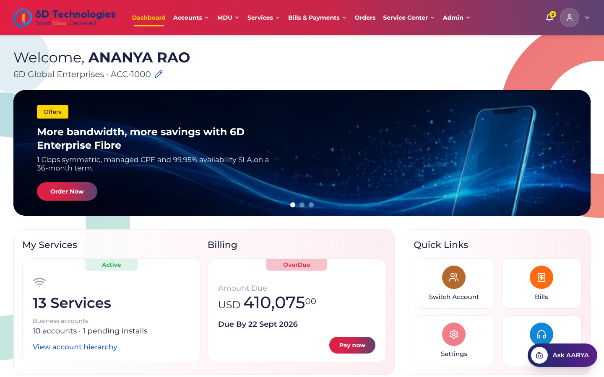

## Contents

1. [Executive summary](#1-executive-summary)
2. [Quick start](#2-quick-start)
3. [Demo personas](#3-demo-personas)
4. [Guided demo script (journeys A–L)](#4-guided-demo-script-journeys-al)
5. [Screen inventory](#5-screen-inventory)
6. [Screenshots](#6-screenshots)
7. [Design rules implemented](#7-design-rules-implemented)
8. [Architecture and data model](#8-architecture-and-data-model)
9. [TM Forum Open API alignment](#9-tm-forum-open-api-alignment)
10. [Look and feel](#10-look-and-feel)
11. [Verification](#11-verification)
12. [Known limits and next steps](#12-known-limits-and-next-steps)

---

## 1. Executive summary

Operators selling enterprise connectivity and FTTH into residential communities usually run three disconnected experiences: a corporate self-care portal, a property-manager spreadsheet process, and a consumer app. This prototype shows them as **one self-care product** with three management dimensions:

| Dimension | What the user can do |
|---|---|
| **Business account management** | Navigate and restructure corporate hierarchies (root → subsidiary → department / branch → service account), create child accounts, delegate administration, view services and consolidated billing |
| **MDU management** | Register properties, generate towers / floors / units, onboard occupants (existing customers by consent, new customers with eKYC), check unit readiness, bulk-onboard units from CSV, and activate broadband for many units in one controlled order |
| **Parent–child accounts** | Keep organisational ownership, billing responsibility and physical premises as **separate, linked structures**, with inheritance, delegated scope and approval-controlled change |

Everything is clickable: there are no placeholder pages or dead buttons. Every journey in the specification runs end to end against a mock, TM Forum–aligned API layer with role- and scope-based access control. All data is synthetic, and every provisioning, payment and approval action is simulated and labelled as such.

**Why it matters (demo narrative).** The storyline runs Enterprise admin → parent account → child account → MDU property → tower → unit → service qualification → order → activation tracking → billing. It shows self-service that would otherwise need operator back-office tickets, and the account-hierarchy and MDU journeys are where the product differentiates.

---

## 2. Quick start

```bash
npm install
npm run dev        # http://localhost:5173
```

| Command | Purpose |
|---|---|
| `npm run dev` | Development server with hot reload |
| `npm run build` | Type-check and produce a static build in `dist/` (relative paths, hostable on any static server) |
| `npm run preview` | Serve `dist/` on http://localhost:4173 |
| `npm run e2e` | Browser smoke test and acceptance journeys (needs `npm run preview` running; set `CHROME_PATH` if Playwright can't find Chrome) |

**In the app:**

- **User menu** (top right): switch demo persona, open **Read me** (the in-app demo guide at `#/guide`), Settings, Logout, and **Reset demo data**.
- **Admin → Read me · Demo guide**: the same walkthrough as this README, with one-click "Start journey" buttons that sign you in as the right persona and open the right screen.
- State persists in the browser (`localStorage`) across refreshes until you reset it.

---

## 3. Demo personas

| Persona | Role | Authorised scope | Use it to show |
|---|---|---|---|
| **Ananya Rao** | Enterprise Super Administrator | 6D Global Enterprises + all descendants | Hierarchy, child-account wizard, moves, approvals, consolidated view |
| **Vikram Shetty** | Business Account Administrator | 6D India subtree | Branch services, delegated admin |
| **Karthik Reddy** | Business Account Administrator (delegated) | Bangalore Office only, no inheritance | Scope isolation (Journey H) |
| **Rahul Iyer** | Billing Administrator | 6D Global Group Billing subtree | Billing hierarchy, invoices, cost allocation |
| **Priya Menon** | MDU Property Manager | Green Valley Residences, Sunrise Heights | MDU journeys C–F and occupant onboarding J–L |
| **Farhan Qureshi** | MDU Property Manager | Sunrise Heights only | Narrow property delegation |
| **Deepa Joshi** | MDU Property Manager (other tenant) | Palm Meadows Towers | Cross-tenant isolation |
| **Sneha Kulkarni** | Resident / Unit Subscriber | Green Valley unit A-104 | Resident isolation (Journey I) |
| **Arjun Nair** | Operator Administrator (demo) | All tenants | Bulk-activation approval, simulated fulfilment |

**Seed data:** 12 business accounts across 3 organisations · 3 properties (Green Valley Residences, Bengaluru, 3 towers / 180 units; Sunrise Heights, Hyderabad, 2 towers / 120 units; Palm Meadows Towers, Pune, 4 towers / 240 units) · 273 services (including Mobile) · 443 customers. Of 435 current occupants, 390 have KYC Verified, 15 Pending Review and 30 Not Started (legacy occupants) · 3 existing Mobile-only customers not yet occupying a unit (Rohit Verma 98450 77001, Ayesha Siddiqui 99001 22334, Vivek Nair 97400 55667) · individual, master / bulk-contract and hybrid billing · 6 months of invoices (246) and payments · 25 tickets and service requests, appointments and pending approvals (including one KYC document review).

---

## 4. Guided demo script (journeys A–L)

| # | Journey | Persona | Steps | What to point out |
|---|---|---|---|---|
| **A** | Create a subsidiary, assign an admin, view the hierarchy | Ananya | Accounts → Create Child Account → parent *6D Global Enterprises* → *Business / Subsidiary* → details → *Create own billing account* + *Invite new administrator* → Submit → **View in hierarchy** | Type rules (a Branch can't hold a Subsidiary); new node highlighted with its ancestors; billing account shown as a dashed link, not a child |
| **B** | Branch services and billing | Vikram | Accounts → *Hyderabad Office* → Services tab → Billing tab | Services are delivered at Hyderabad but **billed to India Corporate Billing**: service location ≠ payer |
| **C** | Register an MDU | Priya | MDU → Register New MDU → property → towers / floors / units → connectivity → *Hybrid* billing → Register → **Open unit grid** | Property ID, buildings, floors and units generated; property billing account created |
| **D** | Qualify a unit and order broadband | Priya | MDU → Buildings / Units → Tower A → **A-302** → *Check service availability* → *Request new connection* → plan + add-ons → billing → installation slot → submit | Then try **C-801**: *Additional Network Work Required* blocks ordering |
| **E** | CSV bulk unit import | Priya | MDU → Bulk Unit Import → *load the demo sample* → review → Import valid rows → download error report | Row-level errors (duplicate, invalid unit type, out-of-scope property, bad contact); **partial success** |
| **F** | Bulk activation | Priya → Arjun | Services → Bulk Activation → Green Valley → *Select all ready* → plan → billing → *Run availability checks* → Submit; switch to **Arjun** → Admin → Approvals → Approve; open the order → *Simulate next provisioning step* ×2 | Per-unit rejection at validation, operator approval, per-unit completed / failed results |
| **G** | Consolidated billing drill-down | Rahul | Bills & Payments → Billing Hierarchy → *6D Global Group Billing* → *India Corporate* → *Bangalore Office Billing*; toggle consolidated vs own invoices | Rolled-up balances (SGD converted to INR at the demo rate) |
| **H** | Delegated admin isolation | Karthik | Accounts (only Bangalore Office); open `#/accounts/ACC-1120` | Refused by the **data layer**, not just hidden in the menu |
| **I** | Resident isolation | Sneha | Dashboard → *My Home* (A-104, plan, bills, tickets); open `#/mdu/PRP-GV` | Sees only their own unit, services (Mobile + Broadband), bills and tickets. KYC shown as Verified via the earlier mobile activation |
| **J** | **New customer** (not registered with us) as occupant | Priya | Unit grid → A-302 → *Assign occupant* → search `90000 12345` → *not yet registered* → **Register new customer** (name, mobile, email, DOB) → duplicate check → privacy notice + consent → **Aadhaar OTP eKYC** (any 12 digits not starting 0/1; OTP `135790`) → relationship and start date, invite to self-care → Confirm | Lookup-first prevents duplicates. Age 18+ check. Only `XXXX-XXXX-1234` is stored. Alternatives: **DigiLocker** (instant) or **document upload** (PAN / Passport / Voter ID / DL), which goes to operator review |
| **K** | **Existing Mobile customer** as occupant | Priya | Occupancy Management → A-103 → *Assign occupant* → search `98450 77001` → masked match (Mobile, KYC Verified) → **Link this customer** → **consent OTP** to their registered mobile (`246810`) → profile unlocks → Confirm | Details stay masked until the customer consents. **KYC reused** from the mobile activation. One customer account across Mobile + Broadband (convergent). Typing the same mobile into *Register new customer* is caught: *Switch to existing customer* |
| **L** | Legacy occupant without KYC | Priya → Arjun | A-205 (Harish Gowda, *KYC Not Started*): resident-billed bulk activation is rejected (*eKYC required*) → unit drawer → **Verify occupant KYC** → document upload (PAN `ABCDE1234F` + file) → switch to **Arjun** → Approvals → approve *KYC Document Review* | Resident-billed services unlock only when KYC = Verified. Rejecting a document sets KYC to Failed with the reason |

**Extra moments worth showing:** hierarchy **Move** (cycle-safe, goes to approval) · unit drawer actions with eligibility reasons · **Update occupant**: the previous occupant is end-dated and their services and billing stay with them · billing reassignment with approval · Ask AARYA quick intents · role switch to see the same screens re-scoped.

---

## 5. Screen inventory

| Area (top nav) | Screens |
|---|---|
| **Dashboard** | Welcome header · offer carousel · My Services / amount-due tiles · Quick Links · KPI tiles · services-by-status, billing trend and MDU penetration charts · profile details |
| **Accounts** | All Business Accounts (KPIs, search, filters, row actions) · **Account Hierarchy** (tree / list, search, expand / collapse, ancestor highlight, side panel, child creation, validated move) · Account Details (Overview, Child Accounts, Services, Billing, Contacts & Users, Requests, Activity History) · Create Child Account (5-step wizard) · Contacts & Delegation |
| **MDU** | MDU Portfolio (cards / table, 7 KPIs) · Register New MDU (5-step wizard) · Property Details (Overview, Buildings & Units, Residents, Connectivity & Services, Billing & Contracts, Requests & Maintenance, Documents, Activity History) · **Buildings / Towers / Units** (unit grid + hierarchy, filters, bulk selection) · Unit drawer · **Occupant onboarding wizard** (find customer → consent OTP *or* new-customer details → eKYC → occupancy → review) · Verify occupant KYC · Occupancy Management (with KYC column) · Bulk Unit Import · My Home (resident) |
| **Services** | Active Services (filters, export) · Subscription page (Current Active Offer, Change Plan, suspend / resume, add-ons, usage, equipment) · Service Availability · New Connection (6-step) · Plan Changes · Bulk Activation (6-step) · Order tracking |
| **Bills & Payments** | Current Bill + Invoice / Payment History · Billing Hierarchy (consolidated vs child) · Invoices (detail, download, simulated pay) · Cost Allocation · Payments · Billing Preferences · Billing reassignment |
| **Orders** | Expandable order cards with pagination → order tracking |
| **Service Center** | Tickets History tiles · All Tickets table · Create Ticket · ticket detail with status timeline (Submitted → Validating → Approved → In Progress → Completed; Rejected / Failed / Cancelled), comments and attachments · Appointments (reschedule) · FAQ |
| **Admin** | Approval Requests (decide / history) · Portal Users (invite, edit access, revoke) · Roles & Permissions matrix · Reports & Analytics (accounts, MDU occupancy and penetration, revenue, operations) · Audit History · **Read me · Demo guide** |
| **Settings** | Customer Settings · Account Settings (Basic Details, Communication Preferences, Approval Policy) · Notifications · Audit History · Logout / persona sign-in |

The layout is responsive: on mobile the top nav collapses to a drawer with a bottom tab bar, and tables become cards.

---

## 6. Screenshots

| | |
|---|---|
| **Account hierarchy**: ownership tree with dashed billing links and ancestor highlight<br>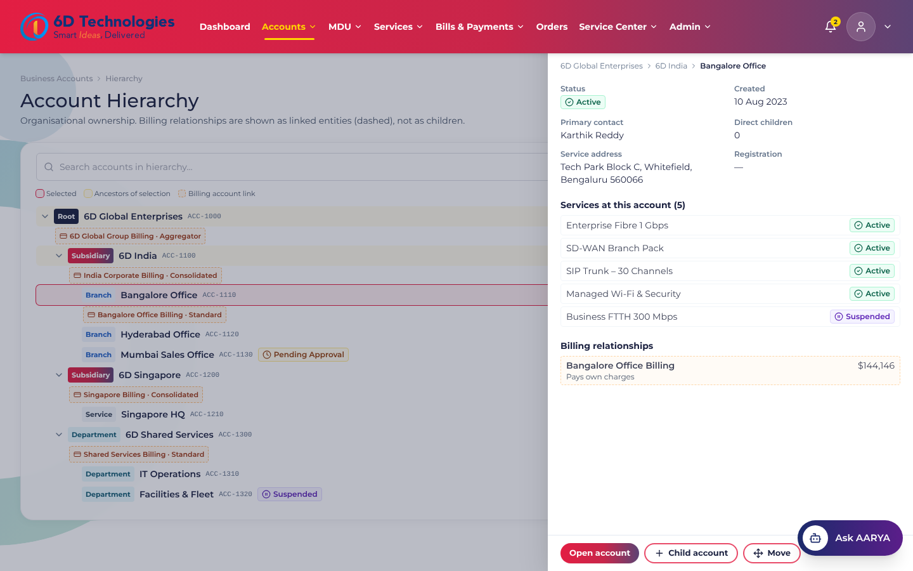 | **MDU portfolio**<br>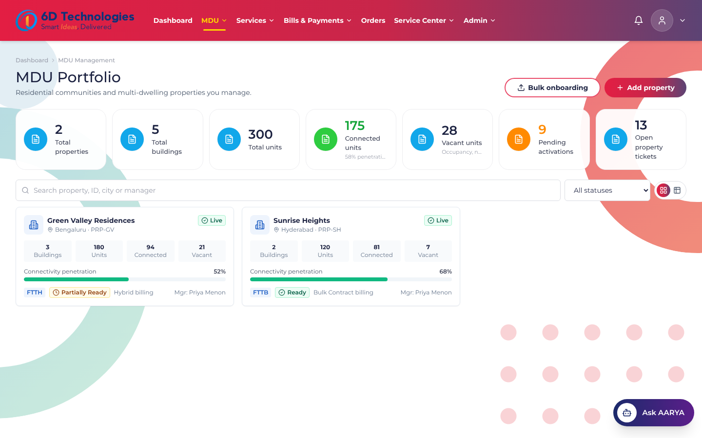 |
| **Property details**: occupancy and connectivity kept separate<br>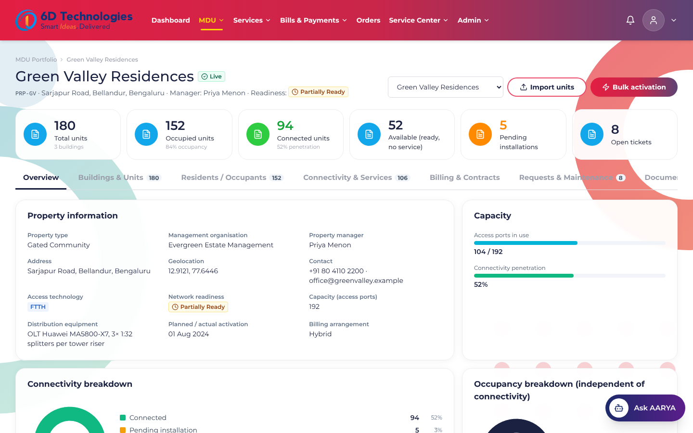 | **Unit grid**: connectivity colour + occupancy glyph<br>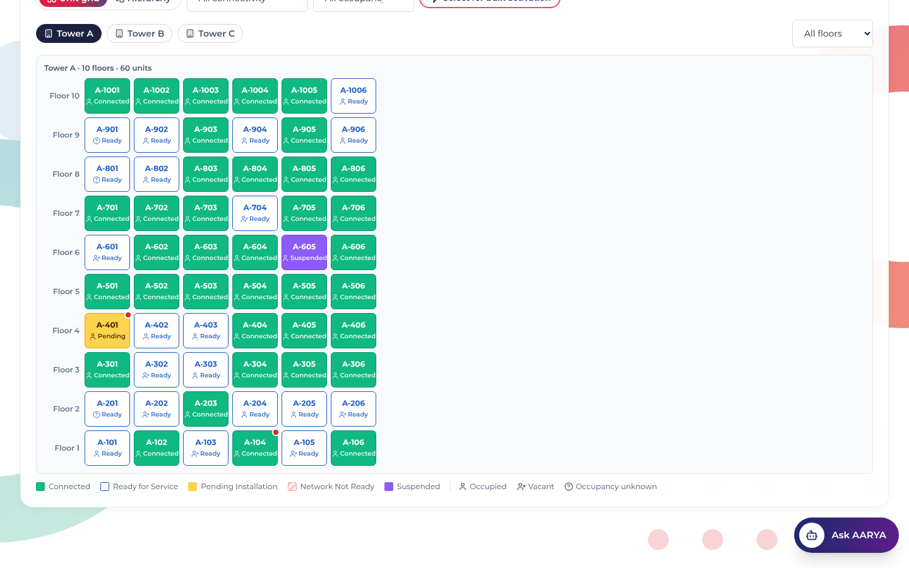 |
| **Unit drawer**: eligibility-checked actions<br>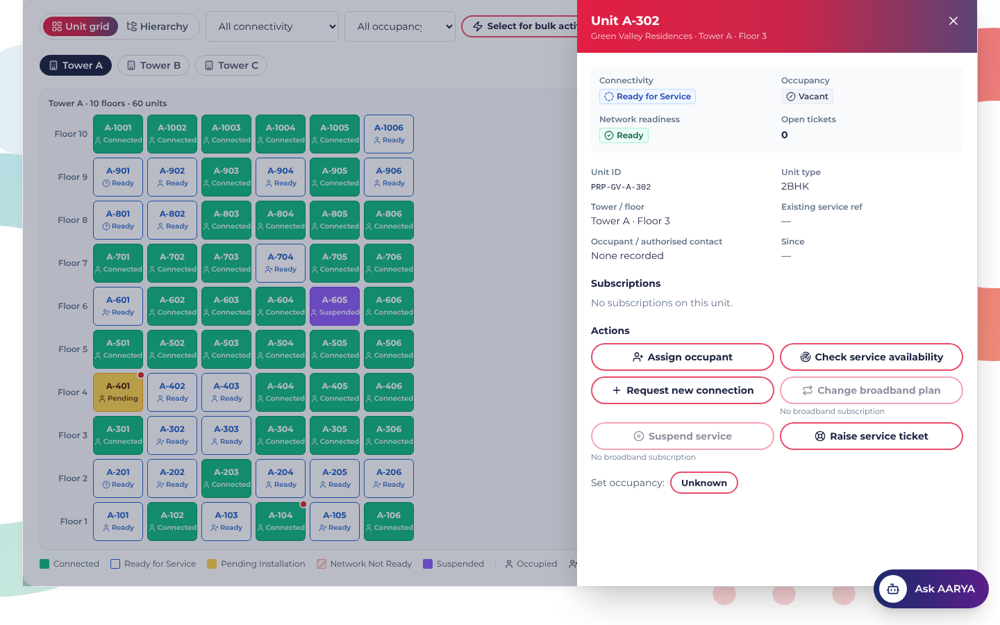 | **Bulk unit import**: row validation, partial success<br>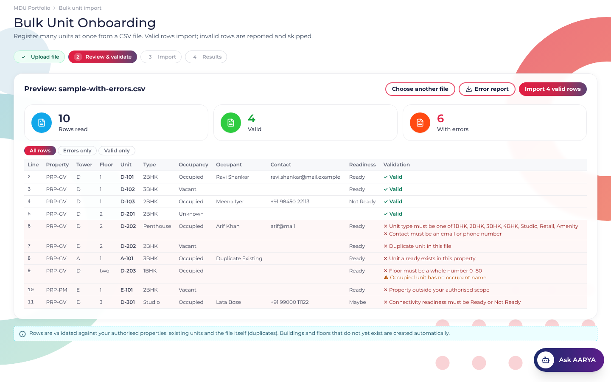 |
| **Bills & Payments**: Current Bill, invoice history<br>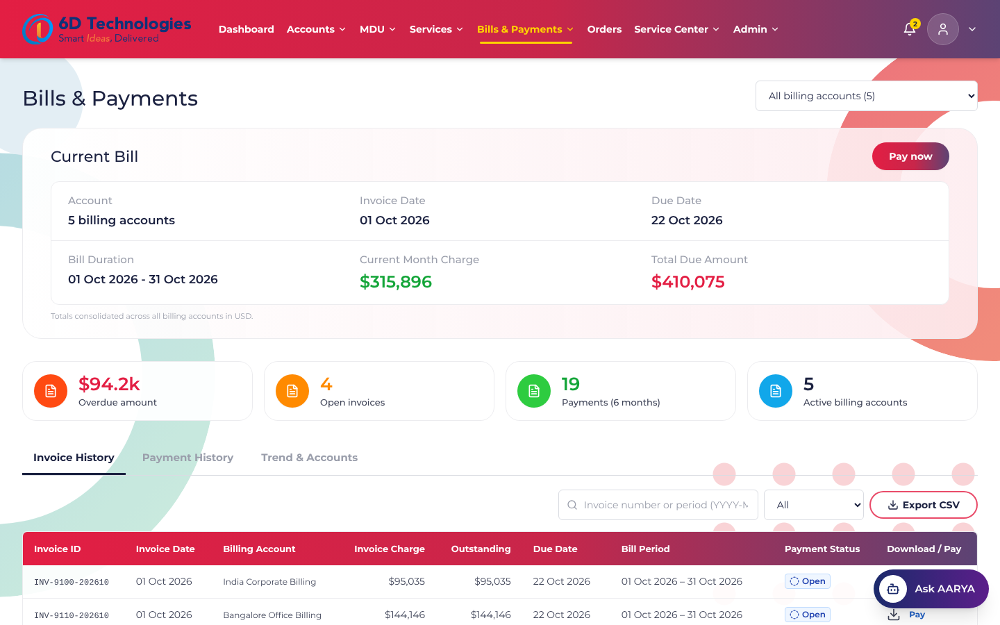 | **Service Center**: Tickets History<br>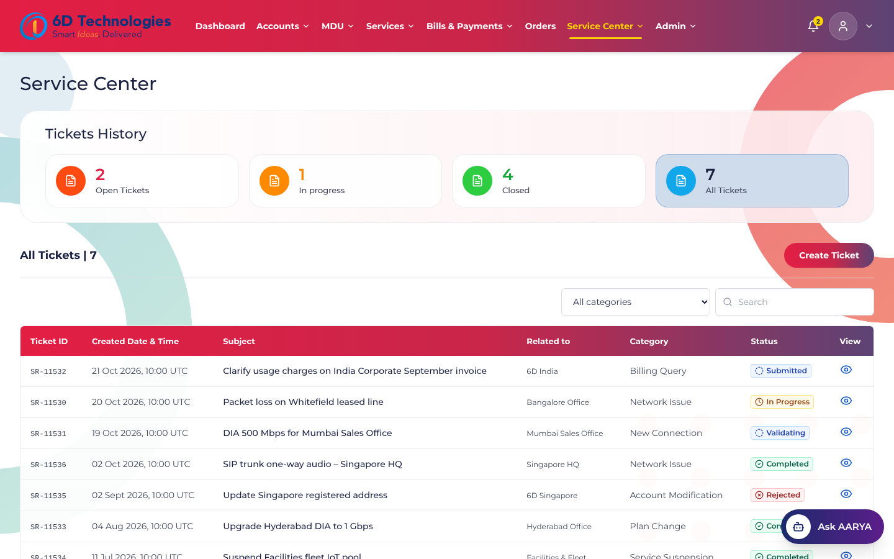 |
| **Approvals**: separation of duties<br>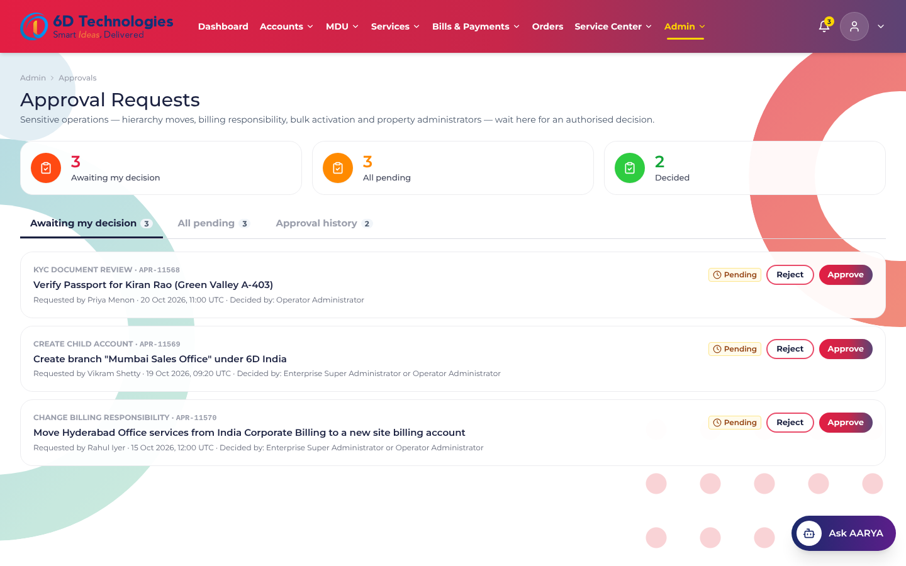 | **Settings**<br>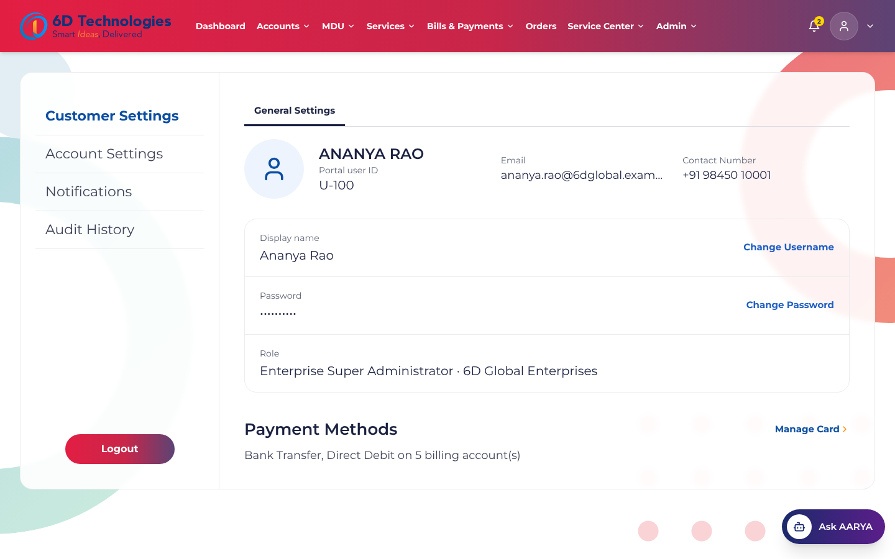 |
| **In-app Read me / demo guide**<br>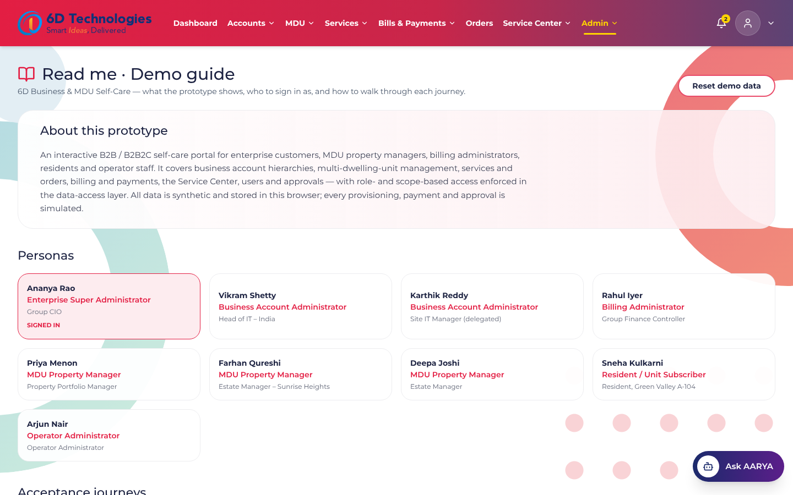 | **Mobile: resident view**<br>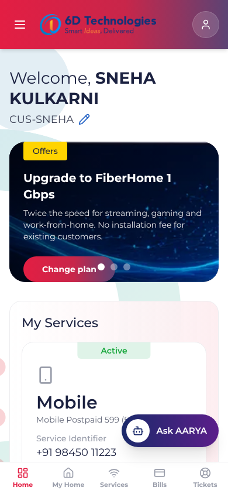 |
| **Occupant onboarding: find customer**. Masked match for an existing Mobile customer<br>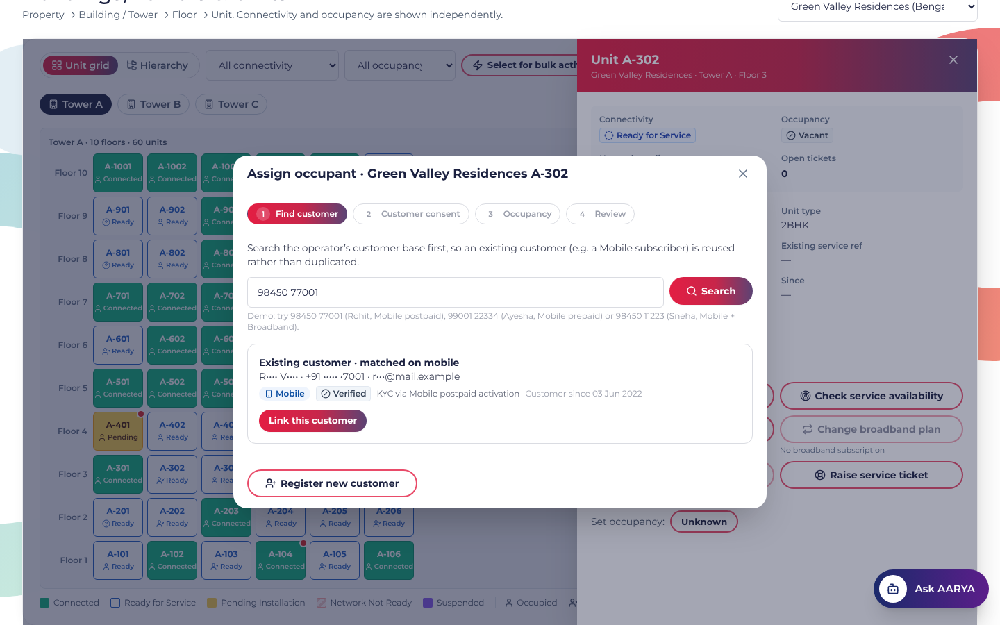 | **Consent OTP**. Profile unlocks and KYC is reused<br>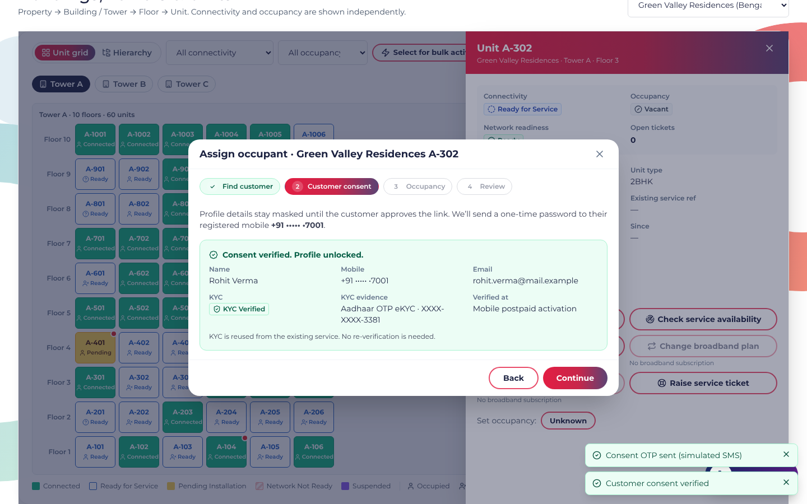 |
| **New customer eKYC**. Privacy notice, Aadhaar OTP / DigiLocker / document<br>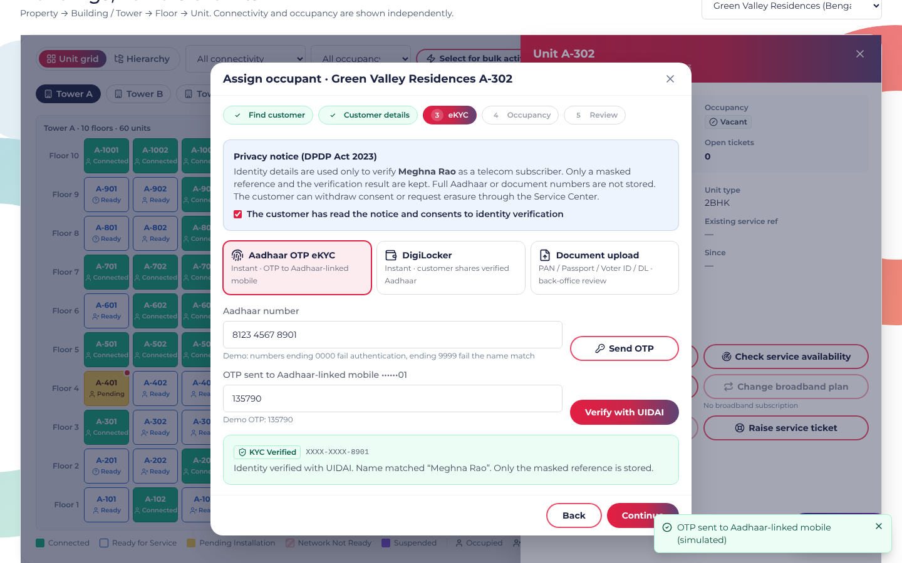 | **Occupancy management with KYC status**<br>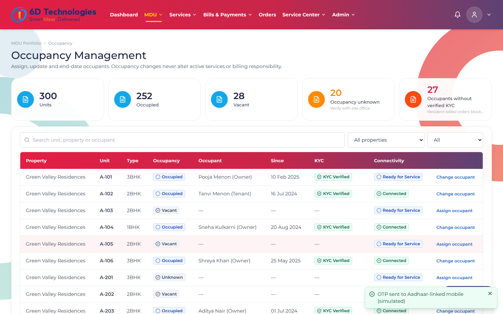 |

---

## 7. Design rules implemented

| Rule (spec §11) | How it is enforced |
|---|---|
| Organisational, billing and premises hierarchies are distinct | `AccountRelationship`, `BillingAccountRelationship` and `Property → Building → Floor → Unit` are separate models; the hierarchy UI renders billing as dashed links |
| A resident is not a child of the property manager | Units link to resident `CustomerAccount`s via dated `OccupancyAssignment`s |
| Service location ≠ billing responsibility | Every service carries its own `billingAccountId`; new orders choose the payer explicitly |
| Effective dating | Moves end-date the old ownership edge; occupant changes end-date the previous assignment |
| No cycles, no cross-tenant leakage | `moveProblem()` blocks self-parenting, descendants, cross-org moves and invalid type pairs, and is re-checked at approval time; all reads are filtered by `resolveScope()` |
| Service status, network readiness and occupancy are separate | Unit connectivity is **derived** from readiness + services; occupancy stored independently; never colour-only |
| Referential integrity | Mutations validate every referenced account, unit, billing account and offering |
| RBAC in the data layer | `src/api/scope.ts` + per-call permission checks; delegation can't exceed the delegator's role or scope; no self-approval |
| Controlled change | Approvals for moves, billing responsibility, sensitive data, bulk activation and property-admin grants; configurable policy for child accounts, bulk activation and billing changes |
| Qualification gates activation | Orders require a passing qualification; *Additional Network Work Required* / *Service Not Available* block the journey |
| Billing doesn't follow occupants | Occupancy changes leave services and billing untouched |
| One customer, many services | Occupant onboarding looks up the operator customer base first (mobile / email / customer ID); a matching Mobile customer is **linked**, not duplicated; *Register new customer* re-checks for duplicates |
| Consent before disclosure | Lookup returns masked name / mobile / email and service categories only; full profile unlocks after an OTP on the customer's registered mobile; every consent is logged on the customer (`ConsentRecord`) |
| Identity before resident billing | New customers complete eKYC (Aadhaar OTP, DigiLocker, or document upload with operator review). `submitNewConnection` and bulk activation refuse resident-billed services unless KYC = Verified; property-billed services are unaffected |
| Data minimisation | Only masked ID references (`XXXX-XXXX-1234`), method, status and timestamps are stored. OTPs and eKYC tokens are short-lived, in memory, and never persisted |

> ⚠️ **Regulatory note.** The prototype simulates, but does not certify, these controls:
> - **DoT / TRAI subscriber verification**: identity is verified before activation.
> - **Aadhaar Act s.29 and UIDAI rules**: no full Aadhaar storage; masked display; eKYC only via a licensed AUA/KUA in production.
> - **DPDP Act 2023**: notice and consent, purpose limitation, consent log, withdrawal and erasure through the Service Center.
>
> Property managers still see occupant names and contacts for their units. Validate that visibility, plus assisted-KYC by property staff, with legal and compliance before customer use.

---

## 8. Architecture and data model

```
src/
  data/types.ts       domain model (~25 entities)
  data/seed.ts        deterministic synthetic seed
  data/store.ts       localStorage persistence + change subscription
  api/scope.ts        scope resolution, hierarchy helpers, Auth/Validation errors
  api/api.ts          mock TMF-aligned adapter: async latency, RBAC on every call
  components/         Layout (top nav, Ask AARYA), UI kit, template blocks, ErrorBoundary
  pages/              feature pages by domain (+ Guide.tsx = in-app read me)
e2e/                  Playwright smoke (all routes × all personas) + acceptance journeys
docs/screenshots/     images used in this README
```

**Stack:** React 18 · TypeScript · Vite · Tailwind CSS · React Router (hash routing for static hosting) · Recharts · Lucide icons.

**Entities:** Tenant · BusinessAccount · AccountRelationship · Contact · BillingAccount · BillingAccountRelationship · Invoice · Payment · CustomerAccount (with KycRecord + ConsentRecord) · Property · Building · Floor · Unit · OccupancyAssignment · ProductOffering · ServiceInstance (product subscription + service) · ServiceQualification · ProductOrder · ServiceRequest · Appointment · ApprovalRequest · AuditEvent · Role · User (with scoped grants) · Settings.

---

## 9. TM Forum Open API alignment

| Domain | Open API | Adapter functions (`src/api/api.ts`) |
|---|---|---|
| Customer / party / party role | TMF629 · TMF632 · TMF669 | `listAccounts`, `getHierarchy`, `createChildAccount`, `requestMoveAccount`, `saveContact` |
| Billing accounts | TMF666 | `listBillingAccounts`, `getBillingHierarchy`, `updateBillingPreferences`, `requestBillingReassignment` |
| Customer bill / payments | TMF678 · TMF676 | `listInvoices`, `payInvoice`, `listPayments` |
| Catalogue / qualification | TMF620 · TMF679 · TMF645 | `offerings`, `checkAvailability`, `previewBulk` |
| Ordering | TMF622 · TMF641 | `submitNewConnection`, `requestServiceChange`, `submitBulk`, `simulateFulfilment` |
| Product inventory | TMF637 | `listServices`, `getService` |
| Trouble ticket | TMF621 | `listRequests`, `createRequest`, `commentRequest` |
| Agreements (bulk contracts) | TMF651 | property billing model / contract documents |
| Users, roles and permissions | TMF672 | `listUsers`, `inviteUser`, `updateUserAccess`, `decideApproval` |
| Premises | TMF673 / TMF674 (mapped, not forced) | `registerProperty`, `listUnits`, `commitImport` |
| Customer identification and eKYC | TMF632 / TMF629 (party and customer search); eKYC gateway (UIDAI AUA/KUA, DigiLocker), outside TMF scope | `lookupCustomer`, `sendConsentOtp`, `verifyConsentOtp`, `requestAadhaarOtp`, `verifyAadhaarOtp`, `fetchDigiLocker`, `submitKycDocument`, `onboardOccupant`, `completeOccupantKyc` |

TMF666 covers billing and financial accounts only. It is deliberately **not** used as the single API for the enterprise hierarchy, and MDU buildings, floors and units live in their own premises domain with configurable mapping.

---

## 10. Look and feel

The UI follows the **6D consumer self-care template** (Service Center, Bills & Payments, Orders and Settings screens):

- crimson → purple gradient top bar with a yellow active-tab underline
- Montserrat typeface
- rounded white cards over the teal-ring, coral-ring and dot-grid background
- gradient pill buttons and gradient table headers
- Tickets-History KPI tiles
- status-tab service tiles
- left-tab settings
- floating **Ask AARYA** assistant

Accessibility basics are in place: skip link, landmarks, keyboard-operable trees and tabs, focus return on dialogs, status glyphs as well as colour, and reduced-motion support.

---

## 11. Verification

```bash
npm run build && npm run preview &
CHROME_PATH=/path/to/chrome npm run e2e
```

- `e2e/smoke.mjs`: loads all 38 routes as all 8 personas and fails on any runtime error or blank page.
- `e2e/journeys.mjs`: drives acceptance journeys **A–L** plus the duplicate-customer guard, the KYC gate on resident billing and cross-tenant isolation and fails on any assertion or page error.

Latest run: **0 runtime errors; all journeys pass**. Mobile check at 390 px: no horizontal overflow.

---

## 12. Known limits and next steps

| Limit | Suggested next step |
|---|---|
| Mock persistence in one browser; no server | Replace `src/api/api.ts` functions with live TMF adapters domain by domain |
| Ask AARYA is a guided, deterministic demo | Connect to the AARYA engine with scope-filtered retrieval and cited answers (TMF AI principles) |
| Authentication is a persona picker | Integrate the operator IdP (OIDC) and map claims to roles and scopes |
| Template matched from screenshots (live site not reachable during build) | Visual QA against the live template |

**Companion artifacts that may help:** a solution document mapping these screens to ODA components, an RFP compliance matrix for B2B/MDU self-care, and a competitive one-pager versus Netcracker, Amdocs and Salesforce Comms Cloud.

*All data is synthetic. No real customer, usage or billing records are used.*
